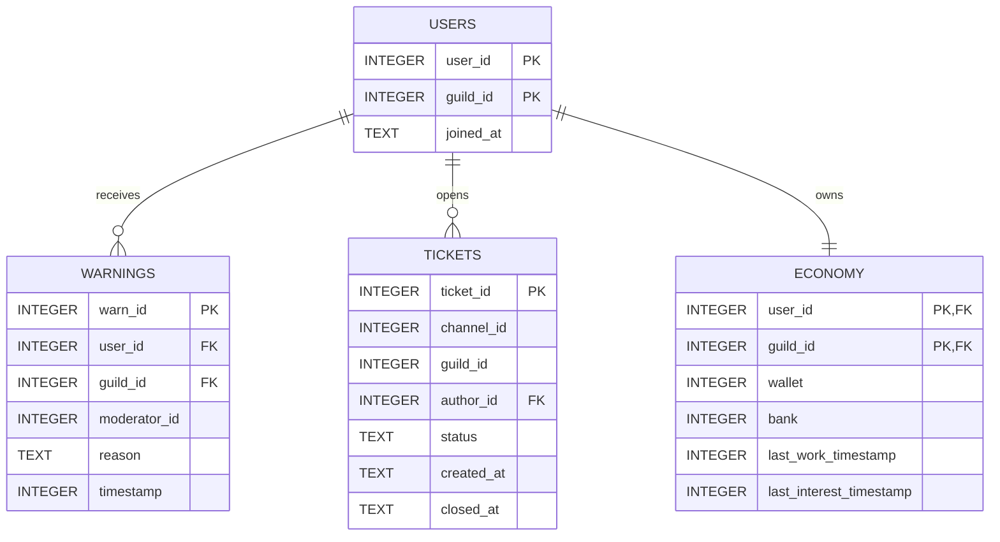

<div align="center">

# ⚡ Nexus Core Support

**Многофункциональный модульный Discord-бот следующего поколения для серверов поддержки, игровых сообществ и управления проектами.**

[](https://www.python.org/)
[](https://github.com/Rapptz/discord.py)
[](https://github.com/omnilib/aiosqlite)
[](LICENSE)
[](https://github.com/psf/black)

[Возможности](#-основные-модули-и-коги) • [Установка](#-установка-и-запуск) • [Команды](#-полный-список-команд) • [База данных](#-архитектура-базы-данных-aiosqlite) • [Конфигурация](#-конфигурация)

</div>

---

## 📖 О проекте

**Nexus Core Support** — флагманский асинхронный Discord-бот, спроектированный для обеспечения полного цикла администрирования, автоматизации технической поддержки, ведения внутрисерверной экономики и защиты от вредоносной активности. 

Архитектура построена на паттерне **Cogs (расширения discord.py)** с полной изоляцией модулей и асинхронным хранилищем на базе **aiosqlite**, что гарантирует высокую производительность при обработке сотен одновременных запросов без блокировки Event Loop.

---

## 🧩 Основные модули и коги

| Ког / Модуль | Описание функционала |
| :--- | :--- |
| **`cogs.moderation`** | Комплексная система модерации: варны, тайм-ауты, кики, баны, очистка сообщений, журналы аудита нарушений. |
| **`cogs.tickets`** | Интерактивная система тикетов через Discord UI Components (Buttons/Select Menus) с созданием приватных каналов и экспортом HTML/текстовых логов. |
| **`cogs.economy`** | Игровая экономика: работы, динамический банковский депозит с начислением процентов, переводы между пользователями, мини-игры (`coinflip`, `slots`). |
| **`cogs.automod`** | Анализатор сообщений в реальном времени: анти-инвайты, блокировка фишинга/скама, анти-спам, анти-флуд и анти-капс с настраиваемыми триггерами наказаний. |
| **`cogs.roles`** | Меню выдачи ролей по кнопкам/реакциям, верификация участников при входе, автоматическое присвоение базовых ролей. |
| **`cogs.system`** | Создание служебных каналов, пинг шлюза Discord API, мониторинг системных ресурсов и статусов модулей. |

---

## 📂 Архитектура репозитория

```text
nexus-core-support/
├── cogs/
│   ├── __init__.py
│   ├── automod.py          # Автоматическая фильтрация контента и спама
│   ├── economy.py          # Экономический движок и банк
│   ├── moderation.py       # Команды модераторов и система варнов
│   ├── roles.py            # Управление ролями и меню верификации
│   ├── system.py           # Системные утилиты и диагностика
│   └── tickets.py          # Система тикетов и стенографирования
├── database/
│   ├── __init__.py
│   ├── db.py               # Пул подключений aiosqlite и инициализация таблиц
│   └── queries.py          # Асинхронные SQL-запросы
├── config/
│   ├── rules.json          # 20 пунктов правил в JSON для Discohook / вебхуков
│   └── settings.example.json
├── data/
│   └── nexus_core.db       # Локальная база данных SQLite (создается автоматически)
├── logs/                   # Логи тикетов и системные события
├── .env.example            # Шаблон переменных окружения
├── .gitignore
├── main.py                 # Точка входа бота (клиент, загрузчик когов, синк дерева команд)
├── requirements.txt        # Список Python-зависимостей
└── README.md
```

---

## 💻 Полный список команд

Все команды реализованы как **Application Commands (Slash Commands)** с автодополнением и валидацией прав.

### 🛡️ Модерация (`cogs.moderation`)

| Слэш-команда | Параметры | Требуемые права | Описание |
| :--- | :--- | :--- | :--- |
| `/warn` | `user: Member`, `reason: str` | `Manage Messages` | Выдать официальное предупреждение участнику. |
| `/warnings` | `user: Member` | `Manage Messages` | Просмотреть список активных варнов пользователя. |
| `/clearwarns` | `user: Member` | `Moderate Members` | Очистить все предупреждения участника. |
| `/timeout` | `user: Member`, `duration: int`, `unit: str`, `reason: str` | `Moderate Members` | Временное ограничение отправки сообщений (мут). |
| `/untimeout` | `user: Member`, `reason: str` | `Moderate Members` | Досрочно снять таймаут с участника. |
| `/kick` | `user: Member`, `reason: str` | `Kick Members` | Исключить участника с сервера. |
| `/ban` | `user: Member`, `delete_days: int`, `reason: str` | `Ban Members` | Заблокировать участника с удалением сообщений. |
| `/unban` | `user_id: str` | `Ban Members` | Разблокировать ранее забаненного пользователя. |
| `/clear` | `amount: int (1-100)` | `Manage Messages` | Массовое удаление сообщений в текущем канале. |

### 📬 Тикеты (`cogs.tickets`)

| Слэш-команда | Параметры | Требуемые права | Описание |
| :--- | :--- | :--- | :--- |
| `/ticket_setup` | `channel: TextChannel`, `category: CategoryChannel` | `Administrator` | Отправляет интерактивную панель с кнопкой создания тикета. |
| `/ticket_add` | `user: Member` | `Manage Channels` | Добавить пользователя в текущий открытый тикет. |
| `/ticket_remove` | `user: Member` | `Manage Channels` | Исключить участника из закрытого канала тикета. |
| `/ticket_close` | `reason: Optional[str]` | Все участники тикета | Закрыть тикет, сохранить лог и архивировать канал. |

### 💰 Экономика (`cogs.economy`)

| Слэш-команда | Параметры | Кулдаун | Описание |
| :--- | :--- | :--- | :--- |
| `/balance` | `user: Optional[Member]` | — | Баланс наличных, банковского счета и накопленные %. |
| `/work` | — | 1 час | Отработать смену и заработать NC-Coins. |
| `/deposit` | `amount: int` | — | Внести средства на банковский счет под процент. |
| `/withdraw` | `amount: int` | — | Снять средства с банковского счета. |
| `/pay` | `target: Member`, `amount: int` | — | Перевести средства другому участнику без комиссии. |
| `/coinflip` | `bet: int`, `side: str` | 10 сек | Ставка на орел/решка с множителем $x2$. |
| `/leaderboard` | `page: Optional[int]` | — | Топ богатейших участников сервера по общему капиталу. |

### 🎭 Роли и Автомод (`cogs.roles`, `cogs.automod`)

| Слэш-команда | Параметры | Требуемые права | Описание |
| :--- | :--- | :--- | :--- |
| `/setup_roles` | `channel: TextChannel` | `Administrator` | Развернуть интерактивное меню получения ролей. |
| `/createrole` | `name: str`, `color: str` | `Manage Roles` | Быстрое создание роли с заданным HEX-цветом. |
| `/automod_status` | — | `Administrator` | Текущий статус фильтров анти-спама и анти-ссылок. |
| `/automod_toggle` | `feature: str`, `enabled: bool` | `Administrator` | Включение/выключение конкретных фильтров автомода. |

---

## 🗄️ Архитектура базы данных (aiosqlite)

Бот использует реляционную структуру SQLite, управляемую полностью через асинхронный контекстный менеджер `aiosqlite`.



### SQL DDL Схема:
```sql
CREATE TABLE IF NOT EXISTS users (
    user_id INTEGER,
    guild_id INTEGER,
    joined_at TIMESTAMP DEFAULT CURRENT_TIMESTAMP,
    PRIMARY KEY (user_id, guild_id)
);

CREATE TABLE IF NOT EXISTS economy (
    user_id INTEGER,
    guild_id INTEGER,
    wallet INTEGER DEFAULT 0,
    bank INTEGER DEFAULT 0,
    last_work INTEGER DEFAULT 0,
    last_interest INTEGER DEFAULT 0,
    PRIMARY KEY (user_id, guild_id)
);

CREATE TABLE IF NOT EXISTS warnings (
    id INTEGER PRIMARY KEY AUTOINCREMENT,
    user_id INTEGER NOT NULL,
    guild_id INTEGER NOT NULL,
    moderator_id INTEGER NOT NULL,
    reason TEXT NOT NULL,
    created_at TIMESTAMP DEFAULT CURRENT_TIMESTAMP
);

CREATE TABLE IF NOT EXISTS tickets (
    ticket_id INTEGER PRIMARY KEY AUTOINCREMENT,
    channel_id INTEGER UNIQUE NOT NULL,
    guild_id INTEGER NOT NULL,
    author_id INTEGER NOT NULL,
    status TEXT DEFAULT 'open',
    created_at TIMESTAMP DEFAULT CURRENT_TIMESTAMP,
    closed_at TIMESTAMP
);
```

---

## 🚀 Установка и запуск

### 1. Системные требования
* **Python**: `3.10` или выше
* **Git**
* **Discord Bot Token** со следующими включенными **Privileged Gateway Intents**:
  * [x] **Presence Intent**
  * [x] **Server Members Intent**
  * [x] **Message Content Intent**

### 2. Клонирование репозитория
```bash
git clone https://github.com/yryba/nexus-core-support.git
cd nexus-core-support
```

### 3. Создание виртуального окружения
```bash
# Linux / macOS
python3 -m venv venv
source venv/bin/activate

# Windows (PowerShell)
python -m venv venv
.\venv\Scripts\Activate.ps1
```

### 4. Установка зависимостей
```bash
pip install --upgrade pip
pip install -r requirements.txt
```

### 5. Конфигурация окружения
Создайте файл `.env` на основе `.env.example`:
```bash
cp .env.example .env
```

Заполните переменные:
```env
# Discord Bot Credentials
DISCORD_TOKEN=MTE5OTg0NDAzNDM5...
CLIENT_ID=119984403439...

# Guild Context (Для мгновенной синхронизации слэш-команд при тестировании)
DEV_GUILD_ID=123456789012345678

# Database Path
DATABASE_PATH=data/nexus_core.db

# Settings
DEFAULT_PREFIX=!
EMBED_COLOR=0x00F0FF
```

### 6. Запуск бота
```bash
python main.py
```

---

## 🔒 Настройка прав бота (Permissions Integer)

Для бесперебойной работы всех когов боту требуется набор прав:
* **Интегральный код прав (Permissions Integer)**: `1100585331798` (или `8` для флага Администратор).
* Минимальные разрешения:
  * Manage Roles, Manage Channels, Kick Members, Ban Members
  * Send Messages, Send Messages in Threads, Embed Links, Attach Files
  * Read Message History, Use External Emojis, Use Slash Commands
  * Moderate Members (Timeout)

---

## 🤝 Вклад в проект (Contributing)

1. Сделайте Fork репозитория.
2. Создайте ветку фичи: `git checkout -b feature/awesome-feature`.
3. Зафиксируйте изменения: `git commit -m 'feat: add awesome feature'`.
4. Отправьте ветку: `git push origin feature/awesome-feature`.
5. Откройте **Pull Request**.

---

## 📄 Лицензия

Проект распространяется под открытой лицензией [MIT](LICENSE). Вы можете свободно использовать, модифицировать и внедрять данный код в свои решения.
